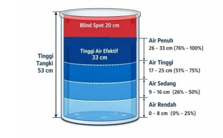
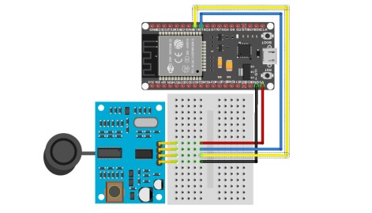
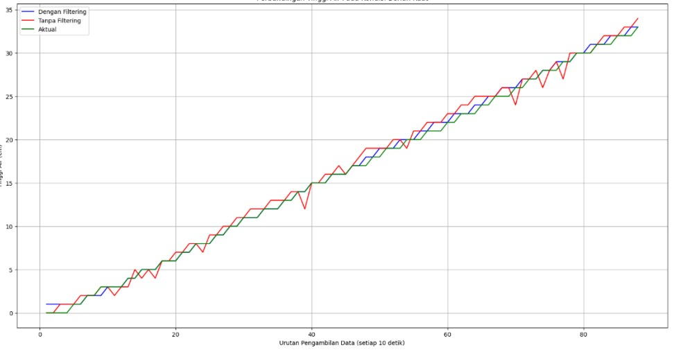

# Monitoring Ketinggian Air Tangki Berbasis ESP32


Sistem pemantauan ketinggian air pada tangki menggunakan **ESP32** dan **dua sensor ultrasonik waterproof JSN-SR04T**. Satu sensor memakai **filter** (median + moving average) dan satu sensor dibaca **mentah (raw)**, sehingga hasil keduanya dapat dibandingkan langsung. Data dikirim lewat Serial dan direkam otomatis ke file Excel oleh skrip Python.

> Proyek Kerja Praktik, Teknik Informatika, Universitas Komputer Indonesia (UNIKOM).

---

## Fitur Utama

- **Dua sensor ultrasonik** dalam satu alat: Sensor 1 (filtered) dan Sensor 2 (raw)
- **Filter berlapis** pada Sensor 1: median 7 sampel, lalu moving average 5 data
- **Klasifikasi status air** otomatis: Rendah, Sedang, Tinggi, Penuh
- **Penanganan error**: pembacaan di luar rentang valid ditampilkan sebagai `ERR`
- **Akuisisi data otomatis** ke Excel (`.xlsx`) lengkap dengan timestamp
- Firmware ringan, tanpa library tambahan

---

## Cara Kerja

```
JSN-SR04T (x2) → ESP32 → Serial (9600 baud) → Python (pyserial) → Excel (.xlsx)
```

### Perhitungan ketinggian air

Sensor dipasang di bagian atas tangki menghadap ke permukaan air.

```
jarak (cm)      = durasi_echo (µs) × 0,034 / 2
tinggi_air (cm) = tinggi_tangki − jarak
```

### Parameter

| Parameter | Nilai | Keterangan |
|---|---|---|
| `tinggi_tangki` | 53 cm | Jarak sensor ke dasar tangki |
| `blindspot` | 20 cm | Pembacaan di bawah nilai ini diabaikan (area buta sensor) |
| Timeout `pulseIn` | 30 ms | Batas waktu menunggu pantulan |
| Interval pembacaan | ± 10 detik | Jeda antar siklus pengukuran |

Karena area buta 20 cm, ketinggian air yang dapat terukur adalah sekitar **0 – 33 cm**.

### Filter pada Sensor 1

1. Ambil **7 sampel** jarak (jeda 70 ms), buang yang di luar rentang valid
2. Urutkan sampel valid dan ambil **median**
3. Masukkan median ke buffer, hitung **moving average 5 data terakhir**

Sensor 2 hanya membaca satu kali per siklus tanpa filter, sebagai pembanding.

### Status air

| Tinggi air | Status |
|---|---|
| ≥ 26 cm | `AIR PENUH` |
| 17 – 25 cm | `AIR TINGGI` |
| 9 – 16 cm | `AIR SEDANG` |
| 0 – 8 cm | `AIR RENDAH` |
| Pembacaan tidak valid | `ERR` |

---

## Perangkat Keras

- ESP32 Dev Module
- 2 × sensor ultrasonik waterproof JSN-SR04T
- Kabel jumper dan sumber daya (USB / adaptor 5V)

### Wiring

| Sensor | Pin Sensor | Pin ESP32 |
|---|---|---|
| Sensor 1 (filtered) | TRIG | GPIO 18 |
| Sensor 1 (filtered) | ECHO | GPIO 19 |
| Sensor 2 (raw) | TRIG | GPIO 21 |
| Sensor 2 (raw) | ECHO | GPIO 22 |
| Kedua sensor | VCC / GND | 5V / GND |

---

## Instalasi dan Penggunaan

### 1. Upload firmware ke ESP32

1. Buka `firmware_esp32/monitoring_ketinggian_air/monitoring_ketinggian_air.ino` di **Arduino IDE**
2. Pilih board **ESP32 Dev Module** dan port yang sesuai
3. Klik **Upload**
4. Buka **Serial Monitor** dengan baud rate **9600** untuk melihat output

Contoh output:

```
Sensor1 Filter=24cm AIR TINGGI | Sensor2 Raw=25cm AIR TINGGI.
```

### 2. Rekam data ke Excel

Install dependensi Python:

```bash
pip install pyserial openpyxl
```

Sesuaikan port serial di `akuisisi_data_python/akuisisi_data.py`:

```python
ser = serial.Serial('COM5', 9600, timeout=1)   # ganti COM5 sesuai port ESP32
```

Jalankan:

```bash
python akuisisi_data_python/akuisisi_data.py
```

Tekan **Ctrl + C** untuk berhenti. File akan tersimpan otomatis dengan nama `Data_Tangki_Air_YYYYMMDD_HHMM.xlsx`.

> Tutup Serial Monitor Arduino IDE sebelum menjalankan skrip Python, karena port serial tidak bisa dipakai bersamaan.

Kolom pada file Excel:

| Waktu | Tinggi Air Sensor 1 (cm) | Status Sensor 1 | Tinggi Air Sensor 2 (cm) | Status Sensor 2 |
|---|---|---|---|---|

---
## Visualisasi Data

## Struktur Project

```
MonitoringKetinggianAir/
├── akuisisi_data_python/
│   └── akuisisi_data.py          # perekam data serial ke Excel
├── firmware_esp32/
│   └── monitoring_ketinggian_air/
│       └── monitoring_ketinggian_air.ino   # firmware ESP32
└── README.md
```

---

## Pengembangan Selanjutnya

- Pengiriman data ke cloud / dashboard web secara real time
- Notifikasi peringatan (Telegram / WhatsApp) saat air penuh atau rendah
- Analisis akurasi dan error Sensor 1 (filtered) dibanding Sensor 2 (raw)

---

## Author

**Nabilah Shafa**
Teknik Informatika, Universitas Komputer Indonesia (UNIKOM)
